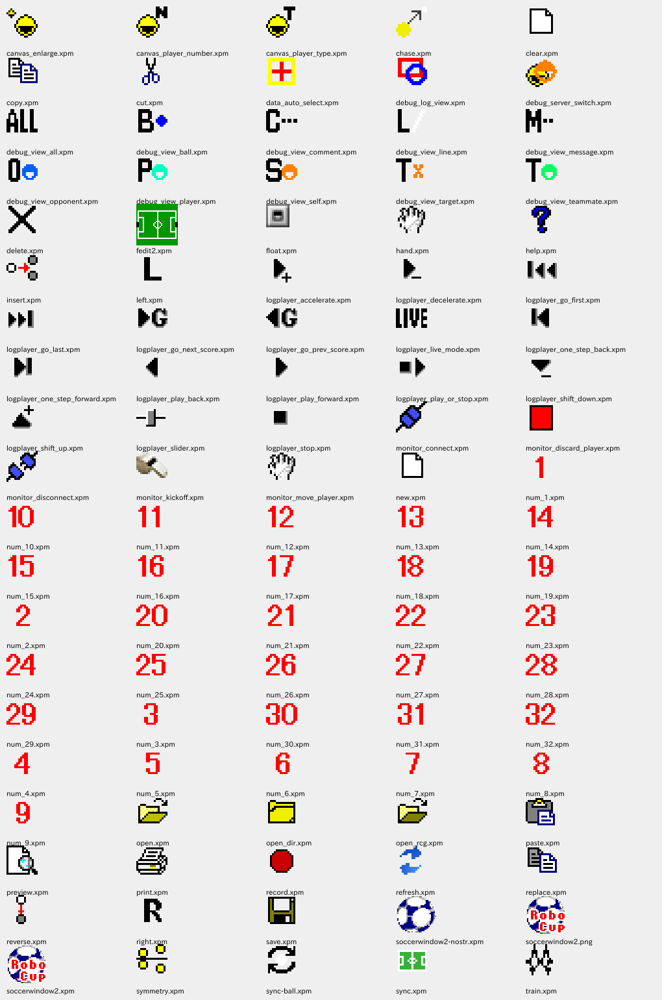
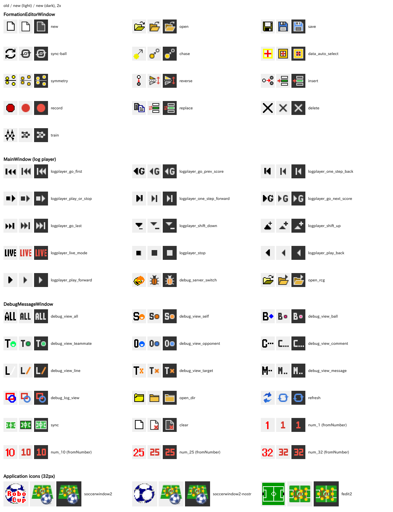

# Old icons

[日本語](README.md) | English

The icons used by soccerwindow2 until November 2026 are kept here as a record.
They were replaced with the new icons (`icons/svg/`, `icons/app/`)
(see [docs/icons.en.md](../../docs/icons.en.md) and the plan `docs/plan/2026-11-21_icon-redesign.md`).

The files in this directory are not used by the build and are not included in the source tarball
(`export-ignore` in `.gitattributes`; they are not listed in `EXTRA_DIST` of Autotools either).

## Files

| File | Description |
|---|---|
| `xpm/` | the old icons (99 XPM files and `soccerwindow2.png`). They were in the top-level `xpm/` and included by the sources. Some of them were not used when they were replaced |
| `soccerwindow2.ico` | the old icon for Windows (32x32, referred to by `src/qt/soccerwindow2.rc`). The current `src/qt/soccerwindow2.ico` is created from the new icon |
| `old-icons.png` | all the icons in `xpm/` (16x16 icons at 3x, 32x32 icons at 2x) |
| `comparison.png` | the old icons and the new icons for the light and dark color schemes (2x) |

## The old icons and the new icons

Most of the icons were replaced with `icons/svg/NAME.svg` of the same name. The following were renamed or made in a different way.

| Old icon | New icon |
|---|---|
| `sync-ball.xpm` | `icons/svg/sync_ball.svg` (the names may contain only `a-z`, `0-9`, and `_`, so `-` became `_`) |
| `num_1.xpm` to `num_32.xpm` | drawn at run time by `UIIcon::fromNumber()` |
| `soccerwindow2.xpm`, `soccerwindow2-nostr.xpm` | `icons/app/svg/soccerwindow2.svg` (the icon of the About menu is the same) |
| `fedit2.xpm` | `icons/app/svg/fedit2.svg` |

The icons that were not used when they were replaced (23 files): `canvas_enlarge`, `canvas_player_number`, `canvas_player_type`, `copy`, `cut`, `debug_view_player`, `float`, `hand`, `help`, `left`, `logplayer_accelerate`, `logplayer_decelerate`, `logplayer_slider`, `monitor_connect`, `monitor_discard_player`, `monitor_disconnect`, `monitor_kickoff`, `monitor_move_player`, `paste`, `preview`, `print`, `right`, `soccerwindow2.png`

## All the old icons

## The old icons and the new icons

For each icon: the old icon, the new icon for the light color scheme, and the new icon for the dark color scheme.

