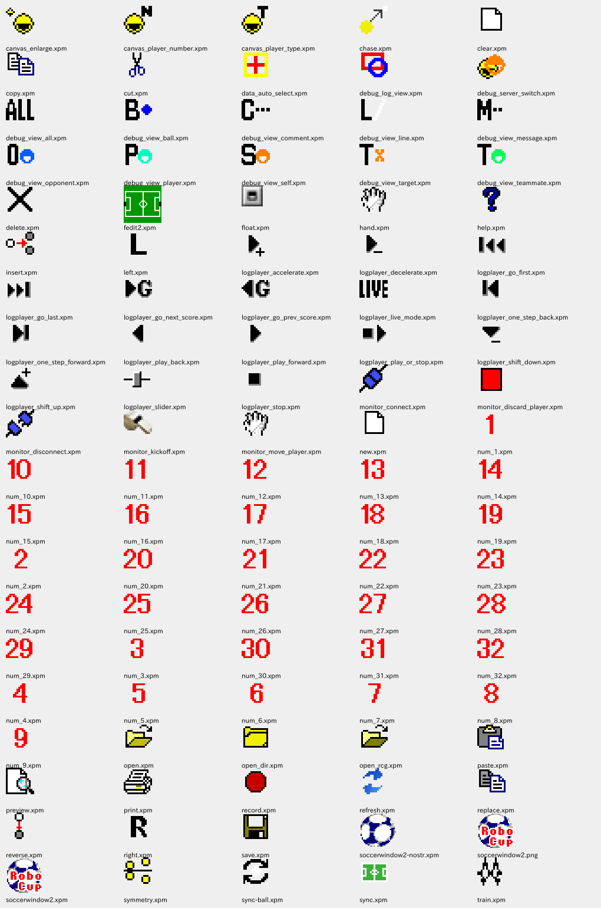
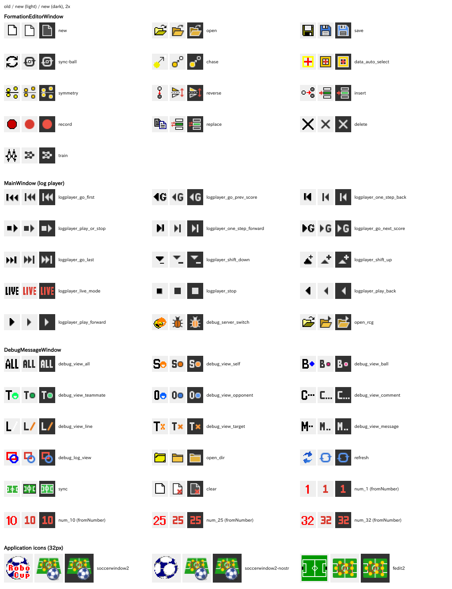

# 古いアイコン

日本語 | [English](README.en.md)

soccerwindow2 が 2026年11月まで使っていたアイコンを、記録・記念として残している。
これらは新しいアイコン（`icons/svg/`、`icons/app/`）に置き換えた
（[docs/icons.md](../../docs/icons.md)、計画書 `docs/plan/2026-11-21_icon-redesign.md`）。

このディレクトリのファイルはビルドでは使わず、配布用の tarball にも含めない
（`.gitattributes` の `export-ignore`。Autotools の `EXTRA_DIST` にも載せていない）。

## ファイル

| ファイル | 内容 |
|---|---|
| `xpm/` | 古いアイコン（XPM 99個と `soccerwindow2.png`）。もとはトップの `xpm/` にあり、ソースから `#include` して使っていた。置き換えた時点で使われていなかったものも含む |
| `soccerwindow2.ico` | 古い Windows 用のアイコン（32×32。`src/qt/soccerwindow2.rc` が参照する）。今の `src/qt/soccerwindow2.ico` は新しいアイコンから作った |
| `old-icons.png` | `xpm/` のすべてのアイコンを並べた画像（16×16 は3倍、32×32 は2倍） |
| `comparison.png` | 古いアイコンと新しいアイコン（明るい配色・暗い配色）の比較（2倍） |

## 古いアイコンと新しいアイコンの対応

ほとんどのアイコンは、同じ名前の `icons/svg/NAME.svg` に置き換えた。名前や作り方が変わったものは次のとおり。

| 古いアイコン | 新しいアイコン |
|---|---|
| `sync-ball.xpm` | `icons/svg/sync_ball.svg`（名前に使えるのは `a-z`、`0-9`、`_` だけなので、`-` を `_` にした） |
| `num_1.xpm`〜`num_32.xpm` | `UIIcon::fromNumber()` が実行時に描く |
| `soccerwindow2.xpm`、`soccerwindow2-nostr.xpm` | `icons/app/svg/soccerwindow2.svg`（About メニューのアイコンも同じものにした） |
| `fedit2.xpm` | `icons/app/svg/fedit2.svg` |

置き換えた時点で使われていなかったアイコン（23個）: `canvas_enlarge`、`canvas_player_number`、`canvas_player_type`、`copy`、`cut`、`debug_view_player`、`float`、`hand`、`help`、`left`、`logplayer_accelerate`、`logplayer_decelerate`、`logplayer_slider`、`monitor_connect`、`monitor_discard_player`、`monitor_disconnect`、`monitor_kickoff`、`monitor_move_player`、`paste`、`preview`、`print`、`right`、`soccerwindow2.png`

## 古いアイコンの一覧

## 古いアイコンと新しいアイコンの比較

各アイコンについて、左から古いアイコン、新しいアイコン（明るい配色）、新しいアイコン（暗い配色）。

